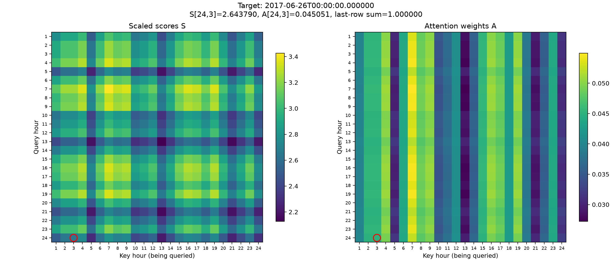

# 第八周：从 LSTM 到单头自注意力

## 1. 固定观察窗口

使用第一条验证样本：

- 第 1 小时：2017-06-25 00:00，油温约 21.245。
- 第 24 小时：2017-06-25 23:00，油温约 20.752。
- 预测目标：2017-06-26 00:00，真实油温约 20.963。

## 2. LSTM 的信息路径

第1小时油温       第2小时油温                 第24小时油温
     ↓                ↓                          ↓
  LSTM第1步 ───→ LSTM第2步 ───→ …… ───→ LSTM第24步
          传递隐藏状态 h 和细胞状态 c                ↓
                                            最后隐藏状态 h24
                                                  ↓
                                                预测层
                                                  ↓
                                            第25小时预测油温

代码中的 output[:, -1, :] 取出第 24 步的隐藏状态，
再交给预测层。

第 1 小时的输入要通过后续状态更新影响预测。
当前模型没有把第 1 步结果直接送给预测层的独立通路。

## 3. 我对直接读取历史的初始想法

每次根据当前窗口的油温，重新决定各小时的权重。

## 4. 单头自注意力的信息路径

固定窗口：
第 1 小时：2017-06-25 00:00
第 24 小时：2017-06-25 23:00
预测目标：2017-06-26 00:00

24个小时的油温
    ↓ 每小时共用同一个线性映射
24个16维输入向量
    ↓ 分别经过三组线性变换
    Q                 K                 V
    │                 │                 │
第24小时的q24 ── 与全部24个键比较           │
                      ↓                 │
                24个缩放分数              │
                      ↓ softmax         │
                24个注意力权重 ──────────┘
                      ↓ 对各小时的V加权求和
                第24位置的16维向量
                      ↓ 预测层
                第25小时预测油温

与 LSTM 不同，第 1 小时可以通过自己的键参与匹配，
通过自己的值参与末位向量的汇总，
无需依次经过第 2 至第 24 步的循环状态更新。

## 5. 固定窗口的数值核对

- 目标时间：2017-06-26 00:00。
- 真实油温：20.962999。
- 预测油温：20.558066。
- 第 24 行第 3 列缩放分数：2.64379001。
- 对应注意力权重：0.04505104。
- 第 24 行权重之和：1.00000000。
- 用末行权重和全部 V 还原末位向量，最大误差约为 5.96e-8。
- 还原的末位向量经过预测层，可以还原模型预测。
- 24 个分数相同时，每个位置的权重都是 1/24，约为 0.04166667。

注意力权重表示对 V 的读取比例，
不能直接解释为各小时对最终油温预测的贡献比例。

## 6. 接口设计

模型默认只返回预测值，供训练和评价使用。
设置 return_details=True 时，同时返回 Q、K、V、
scores、A 和 Z，供数值核对与画图使用。
这样训练和观察使用的是同一次前向计算逻辑。

## 7. 验证集比较

两种模型使用同一批 2880 个验证目标，
指标均在原始油温尺度计算。

| 模型 | 验证样本数 | MAE | RMSE |
|---|---:|---:|---:|
| 第七周选定的 LSTM | 2880 | 0.597546 | 0.914153 |
| 本周单头自注意力 | 2880 | 1.238918 | 1.594348 |

本次实验中，单头自注意力的验证 MAE 和 RMSE 均高于 LSTM，
因此没有获得更好的预测表现。

单头自注意力提供了直接读取各小时信息的路径，
但路径更直接并不保证预测误差更低。
当前模型没有加入位置信息，无法像 LSTM 一样通过循环过程
直接利用观测的先后顺序；这可能限制其预测能力，
但本次比较不能单独确定误差差异的原因。

## 8. 热图观察

左图是缩放分数 S，右图是逐行 softmax 后的权重 A。
每一行表示一个查询位置，每一列表示被查询的位置。

第 24 行第 3 列的分数为 2.64379001，
与同一行其他分数一起归一化后，权重为 0.04505104。
该权重略高于均匀权重 1/24。

这个窗口的权重较为分散，各行的分配模式也较相似。
这只是当前窗口的观察，不能直接推广到全部验证窗口。

## 9. 运行方法与文件说明

在仓库根目录、已安装所需依赖的 Python 环境下运行：

python -m week08.run_attention
python -m week08.inspect_attention
python -m week08.compare_validation

数据：week06/data/ETTh1.csv
复用数据处理：week07/sequence_data.py
复用训练辅助函数：week07/training.py
比较用 LSTM：week07/results/chosen_lstm.pt

本周最佳模型：week08/results/best_attention.pt
最佳轮次：37
训练均值：17.12826170
训练标准差：9.17649102

主要依赖：torch、numpy、pandas、matplotlib。

加载已保存模型后，可以只运行后两条命令，
无需重新训练。